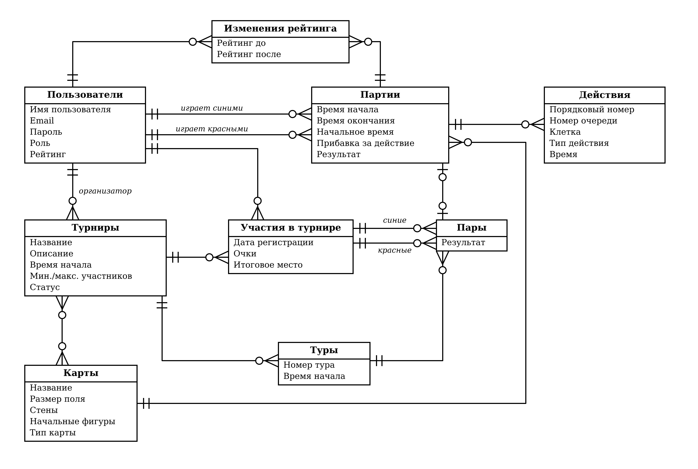

# 2. ИССЛЕДОВАТЕЛЬСКАЯ ЧАСТЬ

## 2.1. Постановка задачи проектирования

Задачей проектирования является разработка веб-платформы, которая позволит двум удалённым игрокам играть в «Вирусы» в реальном времени, самостоятельно находить соперника и участвовать в турнирах. Платформа должна проверять допустимость действий по правилам игры, вести игровые часы, определять результат партии и пересчитывать рейтинг игроков по системе Эло. Все пользователи, карты, партии, действия и результаты турниров должны храниться в реляционной базе данных, чтобы любую партию можно было воспроизвести по шагам, а историю игр и рейтинг просматривать в любое время.

Требуется спроектировать и реализовать систему, которая:

- подбирает соперника с близким рейтингом на выбранной карте или в режиме случайной карты;
- проверяет каждое действие по правилам игры, ведёт игровые часы и определяет результат партии;
- сохраняет партию при обрыве соединения и позволяет игроку вернуться в неё;
- пересчитывает рейтинг игроков по системе Эло после каждой партии;
- проводит турниры по круговой системе без участия организатора после старта: формирует расписание, запускает туры, учитывает неявки и подсчитывает места;
- хранит все партии и позволяет воспроизвести любую из них по шагам.

## 2.2. Описание предметной области

Проведём предварительный анализ предметной области разрабатываемой системы.

«Вирусы» — пошаговая стратегическая игра для двух игроков, которые играют синими и красными фигурами на квадратном поле со стенами. Игроки по очереди выполняют серии из трёх действий: расширяют свою «колонию», ставя новые фигуры на клетки рядом с уже имеющимися, и захватывают фигуры соперника. Партия заканчивается, когда один из игроков лишается возможности действовать, когда у кого-то истекает время или когда игрок сдаётся либо стороны соглашаются на ничью.

В настоящее время в «Вирусы» и родственную им бумажную игру «Война вирусов» играют в основном вдвоём на листе в клетку. При такой игре соперники должны находиться рядом, соблюдение правил проверяют сами игроки, и спорные ситуации трактуются по-разному. Ограничения времени нет, а результаты нигде не сохраняются: нельзя вернуться к сыгранной партии, проследить свой прогресс или сравнить силу игроков. Поле со стенами приходится каждый раз рисовать заново, поэтому на практике играют на одном-двух привычных полях. Турнир между несколькими участниками организуется вручную: расписание составляется заранее, результаты собираются у игроков, а очки подсчитываются организатором. Существующие онлайн-версии родственных игр решают эти задачи лишь частично (подробнее — в подразделе 2.3).

Ограничения предметной области, влияющие на проект:

- в партии участвуют ровно два игрока, игра против компьютера не предусматривается;
- партия проводится на одной карте, которая не меняется в ходе партии, а случайная карта генерируется один раз при создании партии;
- за очередь игрок выполняет ровно три действия, пропуск и отмена действий невозможны;
- размер поля выбирается из фиксированного набора, для каждого размера которого задан контроль времени;
- в турнире от 4 до 16 участников, у турнира один организатор, а изменять турнир можно только до его начала;
- пользователь регистрируется на турнир не более одного раза, и каждые два участника встречаются в турнире ровно один раз;
- допустимость действий и результат партии определяет только сервер.

### 2.2.1. Правила игры

**Поле и карта.** Партия проходит на квадратном поле, которое задаётся картой. Карта определяет размер поля, стены между клетками и, при необходимости, дополнительные начальные фигуры. Карты бывают двух видов: карты основного пула, заранее подготовленные и хранящиеся в системе, и случайные карты, которые генерируются алгоритмом непосредственно перед партией. Стены неизменны в течение партии, за границы поля выходить нельзя. В начале партии в левом верхнем углу ставится синий крестик, в правом нижнем — красный. Цвета игроков назначаются случайно, первым всегда ходит синий.

**Фигуры.** В игре две фигуры: крестик и квадрат. Крестик появляется, когда игрок ставит фигуру в пустую клетку; его может захватить соперник. Квадрат появляется на месте захваченного крестика и принадлежит захватившему: квадрат захватить нельзя. Фигуры не перемещаются, собственные фигуры нельзя заменить или удалить, а тип создаваемой фигуры игрок не выбирает.

**Очерёдность.** Игроки ходят сериями: каждый выполняет по три действия подряд, после чего очередь переходит сопернику. Действием считается одна успешная постановка крестика или один захват; их можно сочетать в любом порядке. Пропускать действия и завершать серию досрочно нельзя. Выбор недопустимой клетки не меняет поле и не расходует действие.

**Допустимость действия.** Игрок может действовать только в клетке, которая связана с его крестиком, то есть соседствует с ним или соединена с ним непрерывной цепочкой его собственных фигур. В пустой клетке появляется крестик игрока, в клетке с крестиком соперника — квадрат игрока; клетки со своими фигурами и квадратами соперника недоступны. Соседними считаются восемь клеток вокруг данной (по сторонам и по диагонали). Связь по стороне закрывает стена на общей стороне клеток, а связь по диагонали отсутствует, только если стены перекрывают оба возможных пути через соседние клетки.

**Время.** У каждого игрока есть общий запас времени на партию. Часы идут только у того, чья очередь, и не останавливаются между действиями серии. За каждое успешное действие игрок получает небольшую прибавку времени. Начальное время и прибавка зависят от размера поля (таблица 1). До первого действия партии часы стоят. Если время игрока истекло, он проигрывает независимо от положения на поле.

Таблица 1 – Контроль времени в зависимости от размера поля

| **Размер поля**  | **Начальное время каждому** | **Прибавка за действие** |
|------------------|-----------------------------|--------------------------|
| 10 × 10          | 2:00                        | 0 с                      |
| 11 × 11          | 3:00                        | 0,5 с                    |
| 12 × 12, 13 × 13 | 3:20                        | 0,5 с                    |
| 14 × 14          | 4:00                        | 0,5 с                    |
| 15 × 15          | 5:00                        | 1 с                      |
| 16 × 16          | 5:40                        | 1 с                      |
| 17 × 17          | 6:00                        | 1 с                      |
| 18 × 18, 19 × 19 | 6:20                        | 1 с                      |
| 20 × 20          | 6:40                        | 2 с                      |
| 25 × 25          | 8:20                        | 3 с                      |

**Завершение партии.** После каждого действия определяется, есть ли у каждого игрока хотя бы одно допустимое действие. Если действия закончились у игрока, который ходит в данный момент, результат определяется сразу. Если они закончились у его соперника, например, из-за заблокированного последнего прохода, то игрок сначала доигрывает свою серию, а затем определяется результат. Результат зависит от числа фигур: каждый крестик и каждый квадрат дают очко своему цвету, а пустые клетки и стены очков не дают (таблица 2).

Таблица 2 – Результат партии по положению на поле

| **Наличие допустимых действий** | **Результат**                                                               |
|---------------------------------|-----------------------------------------------------------------------------|
| Только у одного игрока          | Он выигрывает, если его фигур строго больше, чем у соперника, иначе — ничья |
| Ни у одного из игроков          | Выигрывает игрок с большим числом фигур, при равенстве — ничья              |

Игрок, у которого не осталось действий, не выигрывает, даже если его фигур больше. Кроме того, партия заканчивается победой соперника при исчерпании времени или сдаче, ничьей — при соглашении сторон, а в случае не вернувшегося вовремя игрока — техническим поражением.

### 2.2.2. Организация игры в системе

Игрок, прошедший регистрацию, выбирает карту из основного пула либо режим случайной карты и становится в очередь ожидания. Система подбирает ему соперника с близким рейтингом, выбравшего ту же карту или тот же режим, создаёт партию и случайно назначает цвета. Случайная карта генерируется при создании партии и сохраняется, чтобы партию можно было воспроизвести. Состояние партии принадлежит серверу: игрок указывает выбранную клетку, а сервер проверяет допустимость действия, ведёт часы и объявляет результат. Каждое действие сохраняется с номером серии и временем, поэтому любую партию можно воспроизвести по шагам.

Во время партии игрок может сдаться либо предложить ничью, и соперник принимает или отклоняет предложение. При обрыве соединения партия не теряется: часы продолжают идти, игрок может вернуться и получить актуальное состояние, а если он не вернулся за установленное время, ему засчитывается поражение. За идущей партией могут наблюдать другие пользователи, не вмешиваясь в игру.

Рейтинг игроков рассчитывается по системе Эло. Ожидаемый результат партии определяется разностью рейтингов соперников, а после партии рейтинг победителя растёт, а проигравшего падает на величину, которая зависит от того, насколько результат отличается от ожидаемого; ничья считается за половину победы. Рейтинг до и после партии сохраняется для каждого игрока, на его основе формируется общая таблица рейтинга.

### 2.2.3. Турниры

Кроме обычных партий пользователи проводят турниры по круговой системе, в которой каждый участник играет с каждым один раз. Любой зарегистрированный пользователь может создать турнир, указав название, время начала, допустимое число участников (от 4 до 16) и набор карт из основного пула, на которых будут играться партии турнира. До начала турнира игроки регистрируются и отменяют регистрацию. В назначенное время при достаточном числе участников система формирует расписание, а иначе турнир автоматически отменяется.

Расписание делится на туры: при чётном числе участников их столько, сколько участников без одного, и все играют в каждом туре. При нечётном числе в каждом туре один участник пропускает игру. Каждый тур состоит из пар соперников, для каждой пары система создаёт партию, цвета игроков назначаются случайно. В начале встречи игроки сами выбирают карту из набора турнира или случайную карту. Если выбор совпал, партия играется на выбранной карте, а если нет, система случайным образом выбирает один из двух вариантов; игрок, не сделавший выбор за отведённое время, принимает выбор соперника, а при отсутствии выбора у обоих карта случайная. Размеры карт в турнире не ограничены, а контроль времени каждой партии определяется размером её карты (таблица 1), поэтому в разных турах он может различаться. Если игрок не явился в течение установленного времени, ему засчитывается поражение.

За победу участник получает 1 очко, за ничью — 0,5, за поражение (в том числе за неявку) — 0. По окончании последнего тура места определяются по сумме очков, а при равенстве очков — по коэффициенту Бергера.

### 2.2.4. Модели процессов

Жизненные циклы основных объектов системы задаются наборами статусов и допустимых переходов между ними. Переходы проверяет сервер: переход, не предусмотренный моделью, отклоняется.

Партия создаётся в статусе «Идёт» и один раз переходит в статус «Завершена». При завершении фиксируются результат (победа синих, победа красных или ничья) и причина завершения: положение на поле, истечение времени, сдача, соглашение о ничьей или техническое поражение. Переходы статусов турнира приведены в таблице 3.

Таблица 3 – Переходы статусов турнира

| **Из статуса** | **В статус** | **Кто инициирует**                                                                          |
|----------------|--------------|---------------------------------------------------------------------------------------------|
| —              | Регистрация  | Организатор при создании турнира                                                            |
| Регистрация    | Идёт         | Система в назначенное время при достаточном числе участников; формируется расписание        |
| Регистрация    | Отменён      | Организатор или администратор; система, если к назначенному времени участников недостаточно |
| Идёт           | Завершён     | Система после завершения всех встреч последнего тура                                        |
| Идёт           | Отменён      | Администратор при нарушении правил платформы                                                |

Каждая встреча двух участников в туре (пара) проходит статусы, приведённые в таблице 4.

Таблица 4 – Переходы статусов турнирной встречи

| **Из статуса**   | **В статус**     | **Кто инициирует**                                                                             |
|------------------|------------------|------------------------------------------------------------------------------------------------|
| —                | Ожидание игроков | Система при запуске тура                                                                       |
| Ожидание игроков | Выбор карты      | Система, когда подключились оба участника                                                      |
| Ожидание игроков | Завершена        | Система, если участник не явился за отведённое время: поражение за неявку, партия не создаётся |
| Выбор карты      | Идёт партия      | Игроки выбрали карту или истекло время выбора; система создаёт партию                          |
| Идёт партия      | Завершена        | Система по завершении партии: её результат переносится в пару                                  |

Основные сценарии взаимодействия:

1. **Обычная партия.** Игрок выбирает карту или режим случайной карты и встаёт в очередь; система подбирает соперника, создаёт партию и назначает цвета; игроки по очереди выполняют серии действий. Когда у одного из игроков не остаётся допустимых действий, система определяет результат по числу фигур, сохраняет его и пересчитывает рейтинг обоих игроков в одной транзакции.
2. **Обрыв соединения.** Партия продолжается, часы идут. Если игрок вернулся в пределах отведённого времени, он получает текущее состояние партии и продолжает игру, иначе система засчитывает ему техническое поражение.
3. **Турнирная встреча.** При запуске тура система ожидает подключения обоих участников пары, затем игроки выбирают карту и играют партию. По её завершении система записывает результат пары, начисляет очки и обновляет турнирную таблицу. Когда завершены все встречи тура, запускается следующий тур.
4. **Отмена турнира.** Если к назначенному времени зарегистрировалось меньше участников, чем указал организатор, система отменяет турнир.

### 2.2.5. Участники и их представления данных

Деятельность в системе охватывает следующие роли:

1. **Игрок** — зарегистрированный пользователь: подбирает соперника, играет партии, участвует в турнирах, просматривает свою историю, статистику и рейтинг. Видит свой профиль, статистику и историю партий, общую таблицу рейтинга, список турниров с расписаниями и турнирными таблицами; в партии — поле, часы обоих игроков, число оставшихся действий и историю действий, а в свою очередь — подсветку допустимых клеток.
2. **Наблюдатель** — пользователь, который просматривает идущую партию другого игрока без права действовать. Видит поле, часы и историю действий идущей партии, но без подсветки допустимых клеток и кнопок управления партией; об игроках ему доступны только имя и рейтинг.
3. **Организатор турнира** — любой зарегистрированный пользователь, создавший турнир: он управляет им до начала, а после начала турнир идёт автоматически. Помимо данных игрока видит список зарегистрированных участников своего турнира.
4. **Администратор** — сотрудник, который управляет учётными записями и основным пулом карт и может отменить турнир, нарушающий правила платформы. Видит все учётные записи, пул карт, все турниры и общую статистику системы.

Пароли пользователей не видны никому, включая администратора: в базе данных хранится только их хэш. Адреса электронной почты не показываются другим игрокам и наблюдателям.

### 2.2.6. Границы системы и внесистемное окружение

**Автоматизируются:** регистрация и авторизация пользователей; подбор соперника; проведение партии с проверкой действий, игровыми часами и определением результата; обработка обрыва соединения; пересчёт рейтинга; генерация случайных карт; проведение турниров по круговой системе (расписание, запуск туров, учёт неявок, подсчёт очков и мест); хранение и пошаговое воспроизведение партий.

**Не автоматизируются (внесистемное окружение):** подготовка карт основного пула — их разрабатывают вне системы, а администратор только добавляет готовые карты в пул или отключает их; рассмотрение жалоб на поведение игроков — решение о блокировке принимает администратор, а система лишь исполняет его; призы и любые денежные расчёты; игра против компьютера, обучение и анализ партий; общение игроков между собой.

**Границы применения:** система работает в браузере на настольном компьютере или ноутбуке и рассчитана на умеренное число одновременных партий; турниры проводятся только по круговой системе. Модульная архитектура допускает последующее добавление других форматов турниров и мобильного клиента.

### 2.2.7. Концептуальная модель данных

На основе проведённого анализа предметной области и выявленных процессов была спроектирована концептуальная модель данных (рисунок 1).

Рисунок 1 – Концептуальная модель данных

Модель отражает ключевые сущности системы:

- **Пользователи** — игроки, организаторы и администраторы с учётными данными, ролью и текущим рейтингом.
- **Карты** — игровые поля с названием, размером, стенами, начальными фигурами и типом (карта основного пула или сгенерированная случайная карта). На логическом уровне стены и начальные фигуры будут вынесены в отдельные таблицы.
- **Партии** — сыгранные и идущие партии: время начала и окончания, начальное время, прибавка за действие и результат.
- **Действия** — шаги партии: порядковый номер, номер серии, клетка, тип (постановка или захват) и время.
- **Изменения рейтинга** — записи о рейтинге игрока до и после партии.
- **Турниры** — турниры с названием, описанием, временем начала, границами числа участников и статусом.
- **Участия в турнире** — регистрации игроков на турнир с датой регистрации, набранными очками и итоговым местом.
- **Туры** — этапы расписания турнира.
- **Пары** — встречи двух участников в туре с результатом.

Связи показывают:

- Один пользователь может сыграть много партий, в каждой партии участвуют ровно два игрока: синий и красный.
- Каждая партия проводится на одной карте, а на одной карте может быть сыграно много партий. Случайные карты после генерации сохраняются в системе, поэтому партию можно воспроизвести.
- Турниры и карты связаны отношением «многие ко многим»: у турнира есть набор карт, из которого игроки выбирают карту для своей партии (или выбирают случайную), а одна карта может входить в наборы многих турниров.
- Партия состоит из множества действий, каждое действие принадлежит одной партии.
- Для каждой партии сохраняются записи об изменении рейтинга обоих игроков; у пользователя таких записей может быть много.
- Один пользователь может создать много турниров, но у турнира только один организатор.
- Пользователи и турниры связаны отношением «многие ко многим» через участия в турнире: пользователь может участвовать во многих турнирах, а в турнире — много пользователей.
- Турнир состоит из нескольких туров, а тур — из нескольких пар.
- Каждая пара ссылается на два участия в турнире (синий и красный игроки) и на необязательную партию: при неявке игрока или пропуске тура партии у пары нет. Партия вне турнира с парой не связана.

При проектировании определено, какие данные хранятся, а какие вычисляются:

- состояние поля в ходе партии не хранится: оно восстанавливается из карты и последовательности действий, что и позволяет воспроизвести партию по шагам;
- текущий рейтинг хранится в пользователе для быстрого построения таблицы рейтинга и всегда совпадает со значением «рейтинг после» в последней записи об изменении рейтинга;
- начальное время и прибавка за действие копируются в партию при её создании, поэтому изменение значений по умолчанию не влияет на уже сыгранные партии;
- очки и итоговое место хранятся в участии в турнире, но определяются результатами пар и пересчитываются при завершении каждой встречи;
- статистика игрока (число партий, побед, поражений и ничьих) не хранится, а вычисляется по его партиям.

Таким образом, разрабатываемая система должна заменить ручную организацию игры: проверять соблюдение правил и вести часы, подбирать соперника, хранить все партии с возможностью пошагового воспроизведения, вести рейтинг игроков и проводить турниры по круговой системе, не требуя участия организатора после их начала.

## 2.3. Анализ аналогов

В настоящее время существует множество онлайн-платформ для игр с рейтингом и турнирами. Для сравнения были выбраны три системы: МетаШкола, на сайте которой размещена игра «Война вирусов» с правилами, близкими к «Вирусам», Board Game Arena как крупнейший сервис настольных игр, а также igGameCenter, на котором доступна игра Virus Wars. Сравнение по ключевым требованиям к разрабатываемой системе приведено в таблице 5; для наглядности в последнем столбце указана разрабатываемая система.

Таблица 5 – Сравнение онлайн-платформ для игр

| **Требования к системе**          | **МетаШкола**                                          | **Board Game Arena**                       | **igGameCenter**                                       | **ВП «Вирусы»**                                |
|-----------------------------------|--------------------------------------------------------|--------------------------------------------|--------------------------------------------------------|------------------------------------------------|
| Правила, близкие к «Вирусам»      | Есть: ход из трёх шагов, стены в правилах не упомянуты | Игра в рассмотренных источниках не найдена | Классические Virus Wars: 5 шагов за ход, поле без стен | Есть: серия из трёх действий, карты со стенами |
| Карты (пул карт, случайная карта) | Нет: старт всегда из левого верхнего угла              | Игра не найдена                            | Нет: пустые поля 11 × 11, 13 × 13 и 15 × 15            | Пул карт и случайная карта                     |
| Игра с другим игроком онлайн      | Нет: только против компьютера                          | Есть                                       | Есть                                                   | Есть                                           |
| Рейтинг                           | Нет сведений                                           | Собственная система, основанная на Эло     | Списки лучших игроков по очкам, формула не описана     | Система Эло                                    |

Контроль времени, турниры и хранение партий описаны в открытых источниках только для части аналогов, поэтому эти возможности рассмотрены ниже в описании каждой системы.

МетаШкола — российский образовательный сайт для школьников, на котором размещена игра «Война вирусов» [1]. Её правила близки к «Вирусам»: игрок ходит крестиками, каждый ход состоит из трёх шагов, начинать нужно с левого верхнего угла, а захваченные фигуры соперника образуют «живые» и «мёртвые» цепи [1]. Однако выигрывает тот, кто сделает последний ход, без подсчёта фигур, а сама страница игры предлагает только партию против компьютера [1], [2]. Возможности сыграть с другим человеком онлайн, выбрать карту, а также рейтинга, ограничения времени и турниров по этой игре в найденных материалах нет. Поэтому сайт подходит для знакомства с правилами, но не для соревновательной игры между людьми.

Board Game Arena — крупный сервис, где можно играть в настольные игры в реальном времени или по очереди. Рейтинг игроков строится по системе, основанной на Эло [3], а за исчерпание времени игрок получает штраф, и соперник может пропустить его ходы [4]. Турниры поддерживают и круговой формат, при этом все партии круга стартуют одновременно, а в турнирных партиях время выдаётся фиксированным запасом без добавления за ход [5]. Игра «Вирусы» в рассмотренных источниках на платформе не упоминается, а правила каждой игры фиксированы её реализацией. Таким образом, платформа обладает развитой системой рейтинга и турниров, однако игры «Вирусы» на ней нет, а турнирный формат с фиксированным запасом времени и одновременным стартом всех партий круга не соответствует требованиям к разрабатываемой системе.

igGameCenter — бесплатный сайт, где в реальном времени играют в абстрактные настольные игры. Здесь есть Virus Wars, историческая игра, в которую играли на бумаге ещё в 1980-х годах в Санкт-Петербургском государственном университете [6]. Правила близки к «Вирусам»: два игрока по очереди ставят свои вирусы на доступные клетки и «зомбируют» вирусы соперника, а цель — оставить соперника без допустимых ходов [6]. Однако за ход выполняется 5 шагов, игра начинается на пустом поле размерами 11 × 11, 13 × 13 или 15 × 15 без стен и карт, а проигрывает игрок, который не может сделать все шаги, без подсчёта фигур [6]. Сайт позволяет воспроизвести партию и хранит партии неделю [7]. Сведений о турнирах по круговой системе и рейтинге в найденных материалах нет, есть только списки лучших игроков по очкам [6]. igGameCenter — наиболее близкий аналог по правилам, однако он не поддерживает поля со стенами, выбор карты, рейтинг Эло и турниры по круговой системе.

Ни один из рассмотренных аналогов не удовлетворяет полному комплексу требований: 1) правила «Вирусов» с серией из трёх действий и картами со стенами, 2) выбор карты из пула или случайная карта, 3) игра двух живых игроков онлайн с едиными игровыми часами и прибавкой за каждое действие, 4) турниры по круговой системе с обработкой неявки, 5) рейтинг по системе Эло, 6) постоянное хранение и пошаговое воспроизведение партий.

Разрабатываемая система будет создаваться под правила «Вирусов». В ней будут реализованы пул карт со стенами и режим случайных карт, игровые часы с прибавкой за действие, рейтинг Эло и турниры по круговой системе, в которых неявка игрока закрывается техническим поражением. Все партии и действия будут сохраняться в базе данных, чтобы любую партию можно было воспроизвести по шагам.

## 2.4. Перечень задач, подлежащих решению в процессе разработки

**1) Проектирование базы данных:**

- Создание концептуальной и логической моделей БД, включающих таблицы для хранения информации о пользователях, картах (со стенами и начальными фигурами), партиях, действиях, изменениях рейтинга, турнирах, участиях в турнирах, турах и парах, а также связь наборов карт с турнирами.
- Определение ограничений целостности и индексов для основных выборок: история партий пользователя, таблица рейтинга, действия партии, список турниров, расписание и таблица турнира.

**2) Реализация игровой логики и обмена в реальном времени:**

- Подбор соперника из очереди ожидания с учётом рейтинга и выбранной карты.
- Проверка допустимости действий по правилам игры, учёт серии из трёх действий и определение результата партии.
- Игровые часы с прибавкой за действие, обработка обрыва соединения и возвращения игрока, техническое поражение.
- Сдача и предложение ничьей.
- Ведение статусов партий, турнирных встреч и турниров с проверкой допустимых переходов на стороне сервера.
- Пересчёт рейтинга по системе Эло и сохранение изменений.
- Генерация случайных карт и сохранение сгенерированных карт.

**3) Реализация ввода и просмотра данных:**

- Регистрация и авторизация пользователей.
- Выбор карты из пула или случайной карты, выполнение действий в партии.
- Просмотр профиля, статистики, истории партий и пошаговое воспроизведение партии.
- Просмотр таблицы рейтинга и списка идущих партий, наблюдение за партией.

**4) Реализация турниров:**

- Создание турнира с указанием набора карт, регистрация и отмена регистрации участников.
- Формирование расписания по круговой системе и автоматический запуск туров.
- Выбор карты игроками в начале турнирной партии, назначение цветов, обработка неявки.
- Подсчёт очков, формирование турнирной таблицы и определение мест (коэффициент Бергера).

**5) Редактирование и удаление существующих данных:**

- Редактирование данных учётной записи.
- Изменение и отмена турнира организатором до его начала.
- Управление пулом карт и учётными записями пользователей администратором.

**6) Доступ нескольких типов пользователей:**

- Разграничение прав доступа для игроков, наблюдателей, организаторов турниров и администратора.

**7) Разработка пользовательского интерфейса:**

- Создание интуитивно понятного интерфейса игрового экрана с подсветкой допустимых клеток, часами и историей действий, а также страниц профиля, рейтинга и турниров.

**8) Тестирование:**

- Проведение функционального тестирования системы по сценариям из подраздела 2.2.4, включая проверку правил игры, часов, реконнекта и расписания турнира.
- Оценка времени выполнения основных запросов к базе данных и задержки обновления состояния партии.

## 2.5. Обоснование выбора инструментов и платформы для разработки

Система реализуется как единое серверное приложение с модульным делением и отдельным клиентским одностраничным приложением. Платформа рассчитана на умеренную нагрузку, а разработку ведёт один человек, поэтому выделять отдельные сервисы нецелесообразно: единое приложение разворачивается как один процесс, проще в отладке, хранит состояние идущих партий и игровые часы в памяти одного процесса и позволяет записывать результат партии и изменения рейтинга в одной транзакции. Деление кода на модули (авторизация, подбор соперника, игровая логика, рейтинг, турниры, карты) сохраняет возможность дорабатывать их независимо, а при росте нагрузки — выделить в отдельные сервисы.

В качестве СУБД выбрана PostgreSQL — бесплатная реляционная система управления базами данных с открытым исходным кодом [8]. Она поддерживает транзакции с гарантиями ACID, первичные и внешние ключи, ограничения UNIQUE и NOT NULL, а также многоверсионное управление параллельным доступом [8]. Для платформы это важно, потому что результат партии и пересчёт рейтинга обоих игроков должны записываться атомарно, а связи между пользователями, картами, партиями, действиями и турнирами требуют ссылочной целостности.

Для игрового обмена в реальном времени выбран протокол WebSocket. Он позволяет браузеру и серверу обмениваться сообщениями в обоих направлениях по одному постоянному соединению, не открывая отдельное HTTP-соединение для каждого сообщения [9]. Прежде для таких задач, в том числе для игровых приложений, приходилось постоянно опрашивать сервер по HTTP, и каждое сообщение при этом несло накладные расходы заголовка запроса [9]. В «Вирусах» сервер должен сам и сразу сообщать игроку о действии соперника, обновлять часы, передавать предложения ничьей и рассылать состояние партии наблюдателям, поэтому постоянное двустороннее соединение подходит лучше опроса. Операции, которым не нужно реальное время (регистрация, профиль, история партий, рейтинг, список турниров), выполняются обычными HTTP-запросами через REST API.

Серверная часть реализуется на языке Python с использованием фреймворка Flask. Это лёгкий WSGI-фреймворк, который позволяет быстро начать разработку и при необходимости развить приложение до сложного [10]. Flask не навязывает структуру проекта и поддерживает модульное построение приложения с помощью Blueprints [10], что соответствует предполагаемой архитектуре платформы с отдельными модулями авторизации, игровой логики, рейтинга и турниров. Для обмена по WebSocket используется расширение Flask-SocketIO, которое даёт приложению на Flask двустороннюю связь с клиентами с малой задержкой, позволяет рассылать сообщения группам клиентов и поддерживает транспорты WebSocket и long-polling [11].

Клиентская часть разрабатывается с помощью библиотеки React, которая позволяет строить интерфейс из отдельных компонентов: они получают данные и описывают, что должно отображаться на экране [12]. Компоненты React пишутся на языке JavaScript [13], а разметка и оформление страниц задаются средствами HTML и CSS [14]. Игровой экран естественно раскладывается на компоненты (игровое поле, часы, история действий, список турниров), а при поступлении от сервера нового состояния партии интерфейс обновляется автоматически, без перезагрузки страницы.

Выбранные инструменты позволяют реализовать все функции платформы: хранение данных с контролем целостности (PostgreSQL), обмен игровыми событиями в реальном времени (WebSocket и Flask-SocketIO), REST API и игровую логику (Flask) и интерактивный интерфейс (React). Все они распространяются свободно и имеют подробную документацию, что позволяет сосредоточиться на модели данных и правилах игры, а не на настройке инфраструктуры.

## СПИСОК ЛИТЕРАТУРЫ

1. МетаШкола. Война вирусов. Правила игры [Электронный ресурс]. URL: https://metaschool.ru/pub/games/viruswar/tutorial.php (дата обращения: 15.11.2026).
2. МетаШкола. Война вирусов. Игра [Электронный ресурс]. URL: https://metaschool.ru/pub/games/viruswar/viruswar.php (дата обращения: 15.11.2026).
3. Board Game Arena. Rating [Электронный ресурс]. URL: https://uk.doc.boardgamearena.com/Rating (дата обращения: 15.11.2026).
4. Board Game Arena. Game clock [Электронный ресурс]. URL: https://sl.doc.boardgamearena.com/Game_clock (дата обращения: 15.11.2026).
5. Board Game Arena Forum. INFO: Thinking Time, Round Robin, Ties, Seeding [Электронный ресурс]. URL: https://forum.boardgamearena.com/viewtopic.php?p=242631 (дата обращения: 15.11.2026).
6. igGameCenter. Virus Wars [Электронный ресурс]. URL: https://www.iggamecenter.com/en/rules/viruswars (дата обращения: 15.11.2026).
7. BoardGameGeek. igGameCenter [Электронный ресурс]. URL: https://videogamegeek.com/wiki/page/igGameCenter (дата обращения: 15.11.2026).
8. PostgreSQL: About [Электронный ресурс]. URL: https://www.postgresql.org/about/ (дата обращения: 15.11.2026).
9. RFC 6455. The WebSocket Protocol [Электронный ресурс]. URL: https://www.rfc-editor.org/rfc/rfc6455 (дата обращения: 15.11.2026).
10. Flask. Документация [Электронный ресурс]. URL: https://flask.palletsprojects.com/ (дата обращения: 15.11.2026).
11. Flask-SocketIO. Репозиторий и документация [Электронный ресурс]. URL: https://github.com/miguelgrinberg/flask-socketio (дата обращения: 15.11.2026).
12. React. Официальный сайт [Электронный ресурс]. URL: https://react.dev/ (дата обращения: 15.11.2026).
13. Флэнаган Д. JavaScript. Подробное руководство [Электронный ресурс]. – 6-е изд. – СПб.: Символ-Плюс, 2018. URL: https://my-js.org/assets/files/definitive_guide-7eea8a7e5bab411a133ba9d0204c214a.pdf (дата обращения: 15.11.2026).
14. Дакетт Дж. HTML и CSS. Разработка и дизайн веб-сайтов [Электронный ресурс]. – М.: Эксмо, 2013. URL: https://books.google.ru/books?id=zcZwDwAAQBAJ (дата обращения: 15.11.2026).
